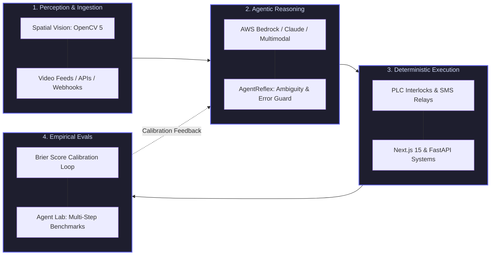

# Hi, I'm Farzan 👋
### Software Engineer · Autonomous AI Systems & Full-Stack Builder

  
  
  
  
  

  <em>Designing autonomous agentic architectures, real-time spatial computer vision, and resilient full-stack platforms.</em> 
  <em>Hypothesis-driven engineering · Tight feedback loops · Empirical evaluation · Production-grade code.</em>

---

### ⚡ Engineering Focus & Architecture

I build systems where **probabilistic AI meets deterministic execution and measurement**. My work centers on autonomous multi-step reasoning, real-time spatial perception, disciplined LLM evaluation harnesses, and high-performance web applications.

---

### 🚀 Featured Systems & Projects

| Project | Highlights & Capabilities | Stack | Stage |
|---|---|---|---|
| 🛡️ [**SafeSight AI**](https://github.com/farzanni/safesight-ai) | **Autonomous Physical Site Safety Supervisor Agent** Pairs OpenCV 5 edge spatial tracking with AWS Bedrock multimodal tool reasoning. Monitors exclusion zones, verifies OSHA mandates in real time, and executes automated PLC interlocks. |     | `OpenCV AI 2026` |
| ⚡ [**AgentReflex**](https://github.com/farzanni/agent-reflex) | **Prompt & Spec Diagnostic Workbench for Coding Agents** Interactive diagnostic auditor stress-testing coding agent specifications across error boundaries, schema ambiguity, and security traps before dispatching tasks. |    | `Devpost Learn` |
| 💈 [**BrbiTime**](https://github.com/farzanni/brbitime) · [🔴 Live: muucut.ir](https://muucut.ir) | **Real-Time Salon Scheduling & Operations Platform** High-throughput appointment booking platform with atomic slot locking, instant SMS alerts via Kavenegar, automated reminder crons, and an HMAC-authenticated business analytics dashboard. |     | `Production` |
| 📈 [**PredictMarket Lab**](https://github.com/farzanni/predict-market-lab) | **Polymarket Forecasting & Scoring Engine** Systematic probabilistic forecasting lab featuring automated market tracking, Brier score resolution, and calibration analysis. Pure Python stdlib without bloated dependencies. |    | `Active` |
| 🤖 [**Agent Lab**](https://github.com/farzanni/agent-lab) | **Evaluation & Benchmarking Harness for LLM Agents** Empirical evaluation framework for benchmarking autonomous agent reliability, reasoning fidelity, and tool-calling failure recovery under reproducible synthetic test suites. |    | `Active` |
| 🎬 [**Fistream**](https://github.com/farzanni/persian-stream) | **FastAPI Streaming Engine & AI Subtitle Pipeline** Zero-bandwidth CDN media proxy paired with Stremio Cinemeta catalog search, multi-provider player failover, and automated AI subtitle translation fallback. |    | `Engineered` |

<b>🔬 Systems & Research in Progress</b>

 

- 🧭 **Conductor Linux** — Parallel AI coding agent orchestrator managing isolated `git-worktree` workspaces from a unified CLI.
- 📱 **Mobile Retail POS Assistant** — Offline-first transaction and inventory assistant engineered in Kotlin.
- 🎙️ **Voice Agent Pipeline** — Low-latency audio streaming, voice activity detection (VAD), and realtime transcription pipeline.
- 🛍️ **Multi-Tenant DM Commerce Agent** — Automated conversational sales assistant utilizing Meta Graph APIs and webhooks.

---

### 🛠️ Technical & Engineering Toolbox

<table width="100%">
  <tr>
    <td width="50%" valign="top">
      <h4>🤖 Autonomous AI, Vision & Evaluation</h4>
      
      
      
      
      
      
    </td>
    <td width="50%" valign="top">
      <h4>💻 Languages</h4>
      
      
      
      
      
      
    </td>
  </tr>
  <tr>
    <td width="50%" valign="top">
      <h4>🌐 Full-Stack & Systems Architecture</h4>
      
      
      
      
      
      
    </td>
    <td width="50%" valign="top">
      <h4>⚙️ DevOps, Cloud & Rigor</h4>
      
      
      
      
      
      
    </td>
  </tr>
</table>

---

### 📊 GitHub Activity & Metrics

  
  

  

---

  <h3>📫 Let's Connect</h3>
  
Always open to collaborating on autonomous AI agents, multimodal vision architectures, or high-reliability products.

  
  
  

